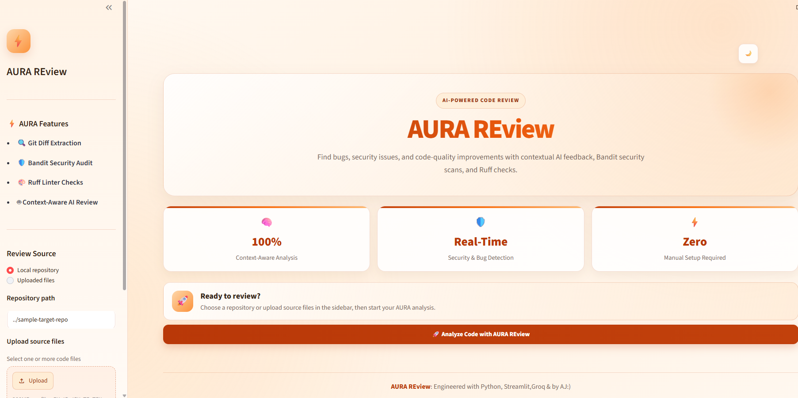
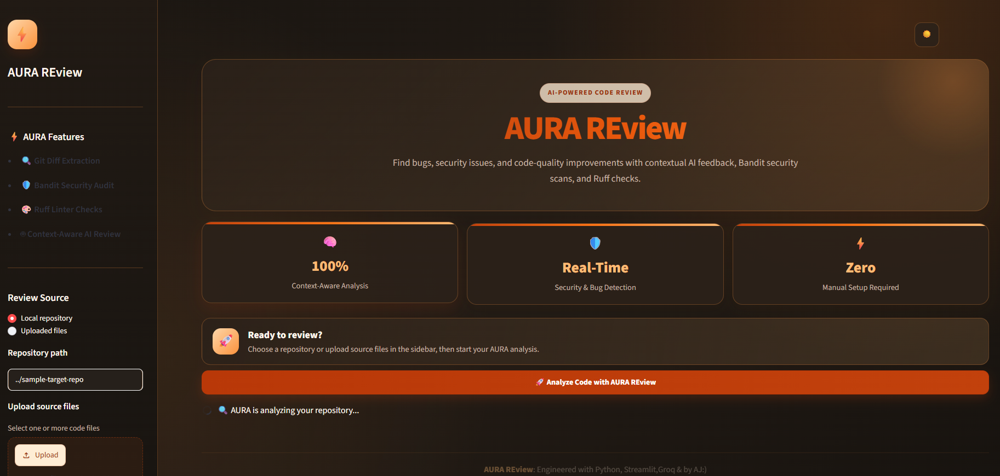
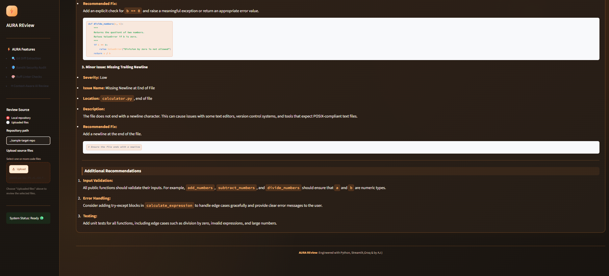
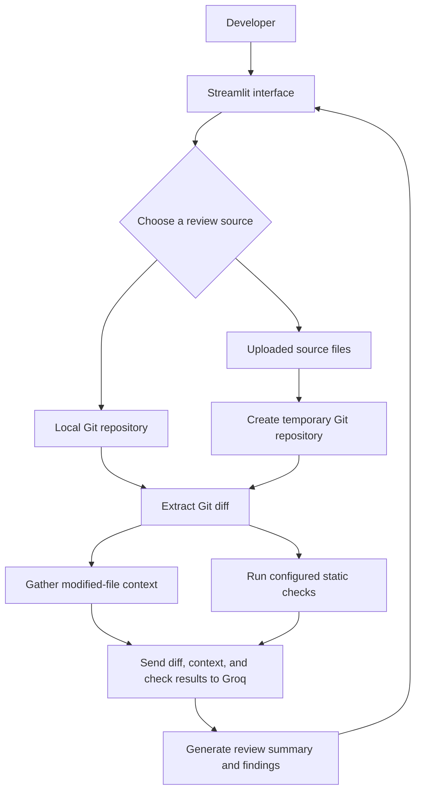

<h1 align="center">⚡ AURA REview</h1>

<p align="center">
  
</p>

<p align="center">
  
  
  
  
  
</p>

<p align="center">
  AI-assisted code reviews with contextual feedback, security checks, and actionable recommendations.
</p>

---

## Overview

**AURA REview** is a Python and Streamlit application for reviewing code changes. It combines Git diff extraction, repository context, static-analysis checks, and a Groq-powered AI review to present findings and suggested fixes.

Review changes in a local Git repository or upload supported source files using the sidebar. Results can include a summary, issue severity, locations, descriptions, recommended fixes, and code examples.

> **Privacy note:** The review sends code and review context to the Groq API configured for the project. Do not upload confidential code unless you are authorized to share it with that service.

## Features

- **Local repository reviews** using a repository path.
- **Uploaded-file reviews** using a temporary Git repository.
- **Git diff extraction** to focus the review on code changes.
- **Context-aware AI feedback** with explanations and suggested fixes.
- **Bandit security checks** and **Ruff lint checks**, as configured in the project.
- **Light and dark themes** with an orange-and-peach interface.
- **Readable review results** with findings and code examples.

## Screenshots

The screenshots below use their original aspect ratio. Each is shown separately at the full available README width rather than being restricted to a table column.

### 1. Light-mode dashboard



*The main dashboard in light mode, including the repository path, file uploader, review source selector, status, and analysis button.*

### 2. Dark-mode dashboard



*The same dashboard in dark mode, showing the theme toggle and review controls.*

### 3. Review findings overview


*The completed review’s summary and findings, including issue details and a recommended code fix.*

### 4. Detailed findings and recommendations



*Further review findings, suggested changes, code examples, and additional recommendations.*

## Review Workflow



## Technologies

| Technology | Role |
|---|---|
| Python | Application and review workflow |
| Streamlit | User interface |
| Groq Cloud API | AI-powered review |
| Qwen | Model configured for AI review |
| Git | Diff extraction and uploaded-file preparation |

Bandit and Ruff are used as review checks; they are intentionally not included in the technology badges at the top.

## Project Structure

```text
ai-code-reviewer/
├── assets/
│   └── screenshots/
│       ├── aura-review-dark-dashboard.png
│       ├── aura-review-findings-details.png
│       ├── aura-review-findings-overview.png
│       └── aura-review-light-dashboard.png
├── .gitignore
├── app.py
├── context_gatherer.py
├── diff_extractor.py
├── list_models.py
├── llm_reviewer.py
├── main.py
├── README.md
├── requirements.txt
└── static_analyzer.py
```

The local `.env`, `venv/`, `.venv/`, and `__pycache__/` folders should not be committed.

## Installation

### 1. Clone the repository

```bash
git clone <your-repository-url>
cd ai-code-reviewer
```

Replace `<your-repository-url>` with your GitHub repository URL. Use the actual project folder name if it differs.

### 2. Create and activate a virtual environment

**Windows PowerShell:**

```powershell
py -m venv .venv
.\.venv\Scripts\Activate.ps1
```

**macOS or Linux:**

```bash
python3 -m venv .venv
source .venv/bin/activate
```

### 3. Install project dependencies

```bash
python -m pip install --upgrade pip
python -m pip install -r requirements.txt
```

Git must be installed and available in your terminal. If Bandit or Ruff is not included in `requirements.txt`, install them in the active virtual environment:

```bash
python -m pip install bandit ruff
```

### 4. Configure the Groq API key

Create a `.env` file in the project root:

```dotenv
GROQ_API_KEY=your_groq_api_key_here
```

`llm_reviewer.py` expects the key to be named `GROQ_API_KEY`. Keep `.env` private—do not commit it or share its contents.

### 5. Start AURA REview

Run this command from the project root:

```bash
python -m streamlit run app.py
```

Open the local URL printed in the terminal.

## How to Use

### Review a local repository

1. Start AURA REview.
2. In the sidebar, select **Local repository**.
3. Enter the local Git repository path. A relative path is resolved from the directory where Streamlit was started.
4. Select **Analyze Code with AURA REview**.
5. Read the generated review below the dashboard.

The current diff extractor runs `git diff`. For a local repository, this reports unstaged changes to tracked files; staged changes and untracked files may not appear.

### Review uploaded files

1. Select **Uploaded files** in the sidebar.
2. Upload one or more supported files.
3. Select **Analyze Code with AURA REview**.
4. Read the review results below the dashboard.

The app prepares uploaded files in a temporary Git repository for analysis. It accepts individual files, not an entire repository folder.

Supported file extensions include:

```text
.py .js .jsx .ts .tsx .java .go .rs .c .h .cpp .hpp
.cs .php .rb .swift .kt .scala .sh .sql .html .css
.json .xml .yaml .yml .toml .md .txt
```

## Troubleshooting

### Repository path not found

Check that the path exists. If a relative path does not work, try entering the full path.

### No changes detected

For local repositories, check that there are unstaged changes to tracked files. The current extractor uses `git diff`, so staged changes and untracked files may not be included.

### Groq review fails

- Check that `.env` contains a valid `GROQ_API_KEY`.
- Confirm that `llm_reviewer.py` can load the environment variable.
- Check that the configured model is available to your Groq account.

### Bandit or Ruff is unavailable

Activate the project's virtual environment, then install the missing tool:

```bash
python -m pip install bandit ruff
```

## Credits

<div align="center">

**AURA REview: Engineered with Python, Streamlit, Groq Cloud, and Git — by AJ :)**

</div>