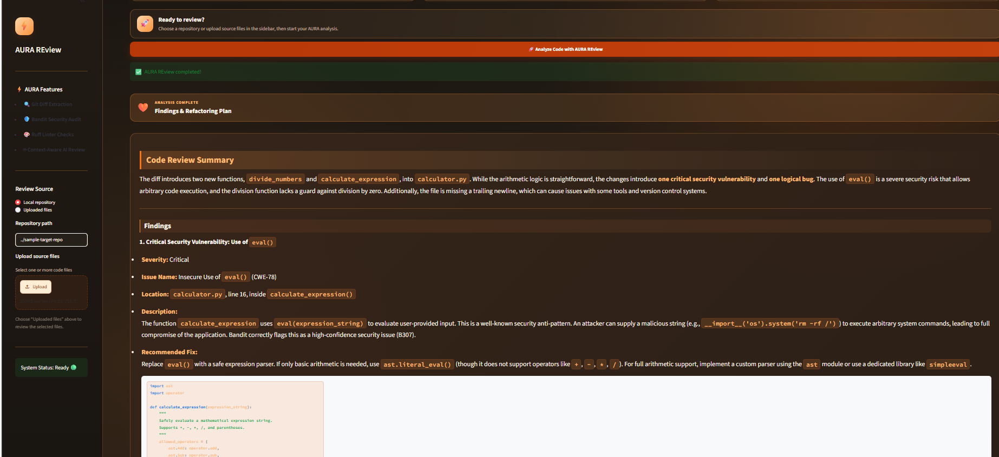
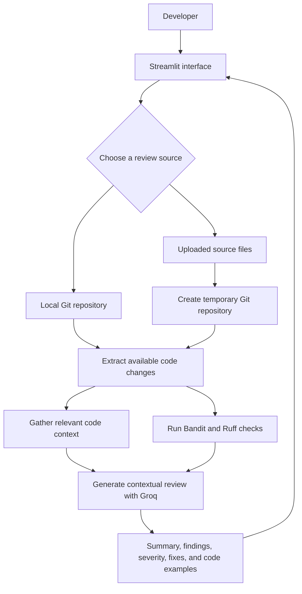

<div align="center">

# ⚡ AURA REview


<br><br>

<strong>BUILT WITH</strong>

<br><br>


<br><br>

**AI-assisted code reviews with contextual feedback, security checks, and actionable recommendations.**

</div>

---

## Overview

**AURA REview** is a Python and Streamlit application for reviewing code changes. It combines Git diff extraction, repository context, Bandit security checks, Ruff linting, and a Groq-powered AI review to present findings and suggested fixes in one place.

You can review changes from a local Git repository or upload supported source files through the sidebar. Reviews include summaries, findings, severity, locations where available, recommended fixes, and code examples.

> **Privacy note:** Review data may be sent to the Groq API configured for the project. Do not submit confidential code unless you are authorized to do so.

## Features

- **Git diff extraction** to focus reviews on changes.
- **Context-aware AI review** with explanations and recommended fixes.
- **Bandit security audit** for Python security findings.
- **Ruff lint checks** for code-quality issues.
- **Local repository review** using a repository path.
- **Uploaded-file review** using a temporary repository.
- **Light and dark themes** with a warm orange-and-peach interface.
- **Readable review results** with findings, locations, recommendations, and code examples.

## Screenshots

Place the screenshots in `assets/screenshots/` using the filenames shown below.

<table>
  <tr>
    <td align="center" width="50%">
      <strong>Light-mode dashboard</strong><br><br>
      
    </td>
    <td align="center" width="50%">
      <strong>Dark-mode dashboard</strong><br><br>
      
    </td>
  </tr>
  <tr>
    <td align="center" width="50%">
      <strong>Review findings overview</strong><br><br>
      
    </td>
    <td align="center" width="50%">
      <strong>Detailed findings and recommendations</strong><br><br>
      
    </td>
  </tr>
</table>

## Review Workflow



## Technology Stack

| Technology | Purpose |
|---|---|
| Python | Application and review workflow |
| Streamlit | User interface |
| Groq Cloud SDK/API | AI-powered code review |
| Git | Change and diff extraction |
| Bandit | Python security auditing |
| Ruff | Linting and code-quality checks |
| Mermaid | Workflow diagram in this README |

## Project Structure

```text
ai-code-reviewer/
├── app.py                  # Streamlit application and user interface
├── main.py                 # Review workflow entry point
├── context_gatherer.py     # Collects relevant repository context
├── diff_extractor.py       # Extracts code changes from Git
├── static_analyzer.py      # Runs static-analysis tools
├── llm_reviewer.py         # Groq-powered AI review
├── list_models.py          # Model-listing utility
├── requirements.txt        # Python dependencies
├── .gitignore
└── assets/
    ├── dark_mode.png
    └── screenshots/
        ├── aura-review-light-dashboard.png
        ├── aura-review-dark-dashboard.png
        ├── aura-review-findings-overview.png
        └── aura-review-findings-details.png
```

Create the `assets/screenshots/` folder if it does not already exist. Keep your local `.env` file out of version control.

## Installation

### 1. Clone the repository

```bash
git clone <your-repository-url>
cd ai-code-reviewer
```

Replace `<your-repository-url>` with the URL of your GitHub repository. If the cloned folder has a different name, change the `cd` command accordingly.

### 2. Create and activate a virtual environment

**Windows PowerShell:**

```powershell
py -m venv .venv
.\.venv\Scripts\Activate.ps1
```

**macOS or Linux:**

```bash
python3 -m venv .venv
source .venv/bin/activate
```

### 3. Install the dependencies

```bash
python -m pip install --upgrade pip
python -m pip install -r requirements.txt
```

Git must be installed and available on your system path. If Bandit or Ruff is not included in `requirements.txt` or is unavailable after installation, install them in the active environment:

```bash
python -m pip install bandit ruff
```

### 4. Configure your Groq API key

Create a `.env` file in the project root and add your API key:

```dotenv
GROQ_API_KEY=your_groq_api_key_here
```

Use the environment-variable name expected by `llm_reviewer.py` if it differs from `GROQ_API_KEY`. Do not commit your `.env` file or share your API key.

### 5. Start the application

Run this command from the project root:

```bash
python -m streamlit run app.py
```

Streamlit will display a local URL in the terminal. Open it in your browser to use AURA REview.

## How to Use

### Review a local repository

1. Start the application.
2. In the sidebar, select **Local repository**.
3. Enter the path to the Git repository. Use an absolute path or a path relative to the directory from which you started Streamlit.
4. Make sure the repository contains changes available for review.
5. Select **Analyze Code with AURA REview**.
6. Read the summary, findings, and recommendations below the dashboard.

If no changes are available to review, the application may report that no uncommitted changes were found.

### Review uploaded files

1. In the sidebar, select **Uploaded files**.
2. Upload one or more supported source files.
3. Select **Analyze Code with AURA REview**.
4. Review the results displayed in the app.

Uploaded files are prepared in a temporary repository for analysis; they are not written into your local project repository.

Supported upload extensions include:

```text
.py .js .jsx .ts .tsx .java .go .rs .c .h .cpp .hpp
.cs .php .rb .swift .kt .scala .sh .sql .html .css
.json .xml .yaml .yml .toml .md .txt
```

## Troubleshooting

### The application reports that the repository path was not found

Check that the path is correct. Try entering its full absolute path instead of a relative path.

### No changes are detected

Confirm that the selected local repository is a Git repository and has changes available for diff extraction. A clean repository may not produce findings.

### The Groq review fails

- Check that your API key is set and has not expired.
- Confirm that `llm_reviewer.py` reads the same environment-variable name used in `.env`.
- Check the model configuration and your Groq API access.

### Bandit or Ruff is unavailable

Confirm the tools are installed in the same virtual environment running Streamlit:

```bash
python -m pip install bandit ruff
```

## Credits

<div align="center">

**AURA REview: Engineered with Python, Streamlit, and Groq Cloud — by AJ :)**

</div>